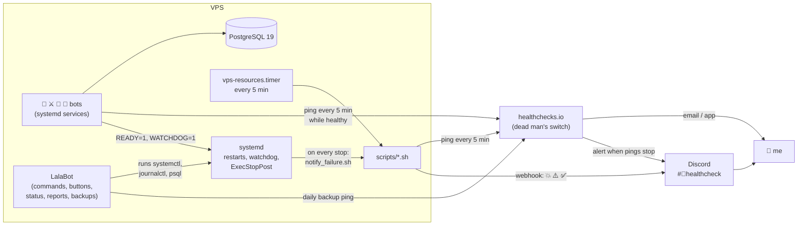

# 🩺 How the bots stay up, and how I hear when they don't

This explains the whole setup behind my four bots on the VPS: what keeps them running, what notices when something breaks, every notification I can get, what LalaBot does, and what every file involved is for.

The bots:

| Bot | Emoji | What it is | Repo folder on the VPS | systemd unit |
| --- | --- | --- | --- | --- |
| **AluBot** | 🦢 | Discord bot (discord.py) | `~/AluBot` | `alubot.service` |
| **Dota2Bot** | ⚔️ | Steam / Dota 2 bot (steam.py) | `~/Dota2Bot` | `dota2bot.service` |
| **IreBot** (IrenesBot) | 💜 | Twitch bot (twitchio) | `~/IrenesBot` | `irebot.service` |
| **LalaBot** | 🖤 | This repo: the Discord bot that looks after the other three | `~/LalaBot` | `lalabot.service` |

The VPS is an Oracle Cloud machine (Ubuntu 22.04, ARM, 4 cores, 24 GB). The three main bots share one PostgreSQL database, `alubot`.

---

## 🗺️ The big picture

The most important idea: **the monitoring lives outside the bots.** A bot can't reliably report its own death. A crashed process sends nothing, and a frozen one can't run its "I'm broken" code. So every kind of failure is caught by something that keeps working when the bot doesn't:



There are four layers, each catching what the others can't:

1. **systemd** keeps the bots running. It restarts a crashed bot, kills and restarts a frozen one (the watchdog), and runs a script every time a bot stops.
2. **Shell scripts in [scripts/](../scripts/)** turn those events into Discord messages through a webhook: crashes, recoveries, low disk or memory, stuck updates. They run from systemd, not from a bot, so they work even when every bot is down.
3. **healthchecks.io**, an outside service, catches what can't report itself. Every bot pings it every 5 minutes *only while it's actually healthy*. When the pings stop, healthchecks.io alerts me: the bot is down, stuck, disconnected, or the whole VPS is gone. This "alert when the pings stop" pattern is called a **dead man's switch**.
4. **LalaBot** is how I *act* on all of that from Discord: restart a bot, read its logs, check the VPS, reboot it. It also runs the daily database backup, the weekly report, and its status light.

### ⚡ Quick map: what breaks → what tells me

| What goes wrong | Who notices | What I get | Fixes itself? |
| --- | --- | --- | --- |
| A bot crashes (exception kills the process) | systemd → `notify_failure.sh` | 💥 in #💖healthcheck within seconds, with the traceback and buttons | ✅ systemd restarts it in 10–30 s |
| A bot crash-loops | same, throttled | one 💥 per 30 min, counting the crashes in between | 🔁 keeps retrying |
| A crashed bot runs steadily again | `check_recoveries.sh` | ✅ "back up" 5–10 min later | — |
| A bot freezes (event loop stuck) | systemd watchdog, after 120 s | 💥 with `result=watchdog` | ✅ killed and restarted |
| A bot runs but is disconnected (Discord/Steam/Twitch/database) | healthchecks.io: the bot stops pinging | healthchecks.io alert after ~9–14 min | usually, when the library reconnects |
| The whole VPS is down or offline | healthchecks.io: everything stops pinging | healthchecks.io alerts for every check | ❌ I have to look (Oracle console) |
| Disk ≥ 90% full or < 10% memory available | `check_resources.sh` | ⚠️ in #💖healthcheck, reminder every 6 h, ✅ when fine | ❌ |
| Security updates not installed for 7 days | `check_updates.sh` | ⚠️ daily until fixed, then ✅ | ❌ |
| VPS needs a reboot for 7 days | `check_updates.sh` | ⚠️ daily, then ✅ | ❌, use `/reboot` |
| The monitoring itself breaks (timer, a check, the webhook) | `ping_monitoring.sh` → healthchecks.io | email / healthchecks.io app | ❌ |
| The daily backup fails | LalaBot | ❌ message in the backups forum post + healthchecks.io `/fail` | retries tomorrow |
| No backup happened at all (LalaBot down at 18:05) | healthchecks.io: no backup ping for 1 day + 2 h | healthchecks.io alert | ❌ |
| A deploy fails (lint, tests, or the bot won't start) | GitHub Actions | GitHub mobile push notification | ❌ |
| A bot logs an exception but keeps running | the bot's own error webhook (shared `ErrorNotificationManager`) | message in that bot's error channel | — |

---

## 🧱 Background: the tools this is built on

You can skip this section if you know systemd well.

### ⚙️ systemd, units and services

**systemd** is the Linux program that starts and supervises everything on the machine. Each thing it runs is described by a **unit file** (an INI-like text file). A unit that runs a long-lived program is a **service**, e.g. `alubot.service`.

The important lines in our bots' unit files (e.g. [lalabot.service](../lalabot.service)):

| Line | Meaning |
| --- | --- |
| `ExecStart=/home/ubuntu/AluBot/.venv/bin/python src/main.py` | the command to run. It's the venv's Python directly, not `uv run`, so the bot itself is the "main process" and systemd's signals, exit codes and notify messages concern the bot, not a wrapper. |
| `User=ubuntu` | run as the normal user, not root |
| `Restart=always` | whenever the process ends (crash or not), start it again… |
| `RestartSec=10` / `30` | …after this many seconds |
| `Type=notify` | the bot tells systemd when it's actually ready (see below) |
| `WatchdogSec=120` | the bot must say "I'm alive" at least every 120 s (see below) |
| `TimeoutStartSec=300` | the bot has 5 minutes to become ready after starting (LalaBot uses the default, 90 s) |
| `ExecStopPost=/bin/sh /home/ubuntu/LalaBot/scripts/notify_failure.sh %n` | a command to run **every time** the service stops, for any reason. `%n` becomes the unit name, e.g. `alubot.service`. |
| `WantedBy=multi-user.target` | with `systemctl enable`, start it at boot |

**Linked, not copied.** Normally unit files live in `/etc/systemd/system/`. Ours live in each repo and were installed once with `sudo systemctl link /home/ubuntu/AluBot/alubot.service`, which puts a *symlink* there. So a `git pull` updates the unit, and `sudo systemctl daemon-reload` (part of every deploy) makes systemd re-read it. Nothing has to be copied by hand.

**The journal.** Everything a service prints (stdout/stderr) goes into systemd's log, the **journal**, together with systemd's own messages about it ("Started alubot.", "Main process exited…"). That's where all bot logs live now: there are no `.log` files anymore. Read it with `journalctl -u alubot`, or `/tail` and `/journal` in Discord. It's kept on disk (survives reboots) and capped at 4 GB, which is about two months.

Useful commands:

```sh
systemctl status alubot            # running? since when? last log lines
sudo systemctl restart alubot      # restart (also: start, stop)
journalctl -u alubot -e            # the journal, jump to the end
journalctl -u alubot -f            # follow it live
systemctl list-timers              # timers and when they run next
```

### 🚦 `Type=notify` and `READY=1`

By default, systemd considers a service "started" the moment its process launches. A bot isn't useful yet at that point: it still has to log in, connect, and so on. With `Type=notify`, the service stays in the state **activating** until the program itself sends the message `READY=1` to systemd. Only then is it **active**.

This matters for three things:

1. `systemctl start` and `systemctl restart` wait for `READY=1`. So **a deploy fails** when a bot crashes during startup: `systemctl restart` reports the failure, the deploy job fails, and GitHub notifies me.
2. "Started alubot." in the journal means it really got ready, which is what the weekly report counts as "up".
3. A bot that never gets ready within `TimeoutStartSec` is killed and counts as a failure.

How a program sends it: systemd gives the service an environment variable `NOTIFY_SOCKET` (a Unix socket path). The program sends the text `READY=1` as a datagram to that socket. That's all `sd_notify()` does in [ext/utils/systemd.py](../ext/utils/systemd.py) and in `shared/systemd.py`. Without `NOTIFY_SOCKET` (a bot started by hand, e.g. at home on Windows) it does nothing, and so does `watchdog_loop()` without `WATCHDOG_USEC`, so running a bot locally needs no special setup.

When each bot sends `READY=1`:

| Bot | When | Where |
| --- | --- | --- |
| AluBot | in `on_ready`, once logged in to Discord | `AluBot/src/core/bot.py` |
| Dota2Bot | after Steam login **and** the Dota 2 Game Coordinator is ready (~30 s+ after Steam) | `Dota2Bot/src/core/bot.py` |
| IreBot | in `event_ready`, once logged in to Twitch | `IreBot/src/core/bot.py` |
| LalaBot | in `setup_hook`, right as it starts (it's tiny and has nothing slow to wait for) | [main.py](../main.py) |

### 🐕 The watchdog (`WatchdogSec=120`)

A **frozen** bot is worse than a crashed one: the process is still there, so `Restart=always` never kicks in. Python asyncio bots freeze when something blocks the event loop (a sync call that hangs, an infinite loop).

The watchdog fixes that. With `WatchdogSec=120`, systemd expects the message `WATCHDOG=1` at least every 120 s. Each bot runs a small background task, `watchdog_loop()`, that sends it every 60 s (half the limit, read from the `WATCHDOG_USEC` variable systemd provides). That task runs **on the bot's event loop**, so if the loop freezes, the pings stop. After 120 s of silence, systemd kills the bot (`SIGABRT`), and it counts as a failure with result `watchdog`. Then `ExecStopPost` posts the 💥 alert and `Restart=always` starts it again.

Where each bot starts it: AluBot in `main.py` (a task, cancelled in `finally`), Dota2Bot in `main.py` (in its `TaskGroup`), IreBot in `main.py`, LalaBot in `setup_hook` in [main.py](../main.py).

### 🧹 `ExecStopPost` and `$SERVICE_RESULT`

`ExecStopPost=` runs after **every** stop: crashes, but also normal stops, restarts and deploys. systemd passes the script environment variables describing why:

| Variable | Examples | Meaning |
| --- | --- | --- |
| `SERVICE_RESULT` | `success`, `exit-code`, `signal`, `watchdog`, `timeout`, `core-dump` | how it ended. `success` = a clean stop (deploy, `/restart`, reboot). |
| `EXIT_CODE` | `exited`, `killed`, `dumped` | whether it exited by itself or was killed |
| `EXIT_STATUS` | `1`, `KILL`, `ABRT`, `TERM` | the exit code or signal |

[scripts/notify_failure.sh](../scripts/notify_failure.sh) stops immediately for `SERVICE_RESULT=success`, so normal restarts never alert.

The flip side: a bot that gives up by *exiting normally* (code 0) also counts as `success` and wouldn't alert, even though it's a failure. That's why AluBot, Dota2Bot and IreBot exit with code 1 when they can't connect to the database at startup, instead of logging the error and returning.

### ⏲️ Timers

A **timer** is systemd's cron: a `.timer` unit starts a matching `.service` unit on a schedule. [vps-resources.timer](../vps-resources.timer) starts [vps-resources.service](../vps-resources.service) 5 minutes after boot and then every 5 minutes. That service is `Type=oneshot`: it runs its commands once and finishes. It has several `ExecStart=` lines, which run **in order**, and if one fails, the rest are skipped (that's used on purpose, see `ping_monitoring.sh`).

### 💓 healthchecks.io

healthchecks.io gives each "check" a secret URL. Requesting that URL is a **ping**. Each check has a **period** (how often pings are expected) and a **grace time** (extra slack). If no ping arrives within period + grace, the check goes **down** and healthchecks.io notifies me. When pings resume, it goes **up** and notifies again. Requesting `<url>/fail` marks it down immediately.

My checks:

| Check | Pinged by | Period / grace | Notifies via |
| --- | --- | --- | --- |
| AluBot, Dota2Bot, IreBot, LalaBot (one each) | each bot, every 5 min while healthy | 5 min / 9 min | Discord integration → #💖healthcheck |
| Database backup | LalaBot, after each daily backup (`/fail` when it fails) | 1 day / 2 h | Discord integration |
| VPS monitoring | `ping_monitoring.sh`, every 5 min | 5 min / 9 min | **email / the healthchecks.io app**, since the Discord webhook may be what's broken |

So a dead bot is reported 9–14 minutes after its last good ping.

### 🪝 Discord webhooks

A **webhook** is a URL that posts a message into one channel when you send it JSON, no bot needed. That's why the shell scripts can post alerts: they just `curl` it. The URL lives on the VPS in `~/.config/failure-webhook-url` (one line, never in git, readable only by `ubuntu`: anyone with the URL can post into the channel).

The webhook in use was created **by LalaBot** with `/alertwebhook`. That matters for buttons: Discord only lets a webhook carry clickable buttons if an application owns it, and it then sends the clicks to that application. So the 💥 alerts can have 🔄 Restart / 📓 Tail / 📁 Journal buttons that LalaBot handles, even though a shell script posted them.

---

## 🔔 Every notification, one by one

### 🐚 In #💖healthcheck, from the scripts (webhook "VPS alerts")

#### 💥 A bot crashed

> @me 💥 `irebot.service` stopped: result=`exit-code` (exited 1)

- *From:* [scripts/notify_failure.sh](../scripts/notify_failure.sh), run by systemd's `ExecStopPost` when a bot stops for any reason other than a clean stop.
- *Contains:* the result (see the `SERVICE_RESULT` table above), the bot's last log lines in a code block (usually the traceback), and the buttons **🔄 Restart**, **📓 Tail**, **📁 Journal**.
- *Throttled:* at most one per bot per 30 min. During a crash loop, the next one adds "plus N more failure(s) since the previous alert".
- *Means:* the bot died. systemd restarts it on its own after `RestartSec` (10 or 30 s). Read the traceback; if it's a crash loop, fix the bug.
- `result=watchdog`: it froze and was killed. `result=timeout`: it didn't get ready within `TimeoutStartSec`. `result=signal (killed KILL)`: something killed it, e.g. out of memory or someone's `systemctl kill`.

#### ✅ A crashed bot is back up

> ✅ `irebot.service` is back up, running for 6 min, after 3 more failure(s) since the last alert

- *From:* [scripts/check_recoveries.sh](../scripts/check_recoveries.sh), every 5 min.
- *Means:* a bot that crashed has now run for at least 5 minutes in a row. The "more failures" part reports the crashes the throttle hid, so I always learn the total.

#### 💽 Low disk space or memory

> @me ⚠️ The VPS is low on disk space: 91% of / is used, 4.1G free

- *From:* [scripts/check_resources.sh](../scripts/check_resources.sh), every 5 min.
- *When:* `/` is ≥ 90% full, or ≤ 10% of RAM is available. Reminds every 6 h while it lasts.
- *Then:* **✅ The VPS has enough disk space again: …** once it's fine.

#### 🔐 Security updates stuck

> @me ⚠️ 12 security update(s) on the VPS aren't installed: is unattended-upgrades broken? (for 8 days)

- *From:* [scripts/check_updates.sh](../scripts/check_updates.sh).
- *Why it exists:* automatic updates once failed silently for about 3 years, while their job kept reporting success.
- *When:* security updates have been pending for 7 days. Reminds daily. *Then:* ✅ "The VPS's security updates are installed."

#### 🔁 Reboot needed

> @me ⚠️ The VPS needs a reboot to finish installing updates: `sudo reboot` (for 7 days)

- *From:* the same script. Ubuntu creates `/var/run/reboot-required` when an update (usually a new kernel) needs a reboot; the alert fires once that file is a week old.
- *Fix:* `/reboot` in Discord. *Then:* ✅ "The VPS is rebooted, the updates are in use."

### 💓 In #💖healthcheck, from healthchecks.io

#### 💓 A bot's healthcheck is down

> "AluBot is DOWN", later "AluBot is UP" (one check per bot)

- The bot stopped pinging for 9+ minutes. It's either not running, or running but unhealthy: each bot only pings when its connections work (see "What each bot's healthcheck checks" below).
- If there's no 💥 alert next to it, the process is still running and something is disconnected. `/tail <bot>` shows what.
- **All of them down at once** = the VPS itself is down or offline.

#### 💾 The backup healthcheck is down

> "Database backup is DOWN"

- Either the daily backup failed (LalaBot pinged `/fail`), or no backup happened for 26 hours (LalaBot was down at 18:05 UTC).

### 📧 By email / the healthchecks.io app

#### 🩺 The monitoring healthcheck is down

> "VPS monitoring is DOWN"

- `ping_monitoring.sh` stopped pinging, or pinged `/fail`. Possible causes:
  - the timer stopped
  - an earlier check script failed (a failing step skips the rest, including the ping)
  - the Discord webhook was deleted or its token changed (the ping body says so)
- In that state, the alerts above can't reach Discord, which is why this check notifies elsewhere.
- *Look at:* `make monitoring`, `journalctl -u vps-resources -e`.

### 💬 Elsewhere in Discord

- **LalaBot's status light**: 🟢 online "All 4 bots up", 🟡 idle "… (re)starting", 🔴 Do Not Disturb "… down". Updated every minute.
- **Backups forum post**: a `.sql` file every day at 18:05 UTC. On failure: "❌ Daily database backup failed, see `/journal lalabot`." with a ping.
- **Weekly report forum post**: every Monday 09:00 UTC, each bot's uptime %, downtime, crashes, auto-restarts and starts over 7 days, plus VPS reboots.
- **After `/reboot`**: "✅ The VPS is back up, the reboot took N s." in the channel where I ran it.
- **Each bot's error webhook**: exceptions that *don't* kill the bot (a failed command, a broken task) go to that bot's error channel, through `shared`'s `ErrorNotificationManager`. That's separate from this setup but covers the "running, but something inside failed" case.
- **Log mirrors**: AluBot, Dota2Bot and IreBot also copy their log lines (INFO and above) into a logs channel through their `WEBHOOK_LOGGER`, using `shared`'s `DiscordWebhookLogs`. Handy for reading along, but it's not an alert: it goes quiet when the bot dies.

### 💜 In Twitch chat

- **"I reloaded myself - commit: …"**: IreBot says this in my chat every time it gets ready. After a deploy it confirms the new commit is running; seeing it repeatedly *without* a deploy means IreBot keeps restarting.

### 📱 Outside Discord

- **GitHub mobile notifications** when a deploy fails.

---

## 🎬 What happens, step by step

### 💥 A bot crashes

Say IreBot raises an unhandled exception at 12:00:00.

1. **12:00:00** The Python process exits with code 1. The journal gets the traceback, then systemd's "irebot.service: Main process exited, code=exited, status=1/FAILURE" and "Failed with result 'exit-code'".
2. **12:00:00** systemd runs `ExecStopPost`: `notify_failure.sh irebot.service` with `SERVICE_RESULT=exit-code`.
3. The script checks its throttle file `~/.cache/notify-failure/irebot.service`: no alert in the last 30 min, so it continues.
4. It waits 2 s (journald may still be writing the last lines), then takes the last 60 journal lines.
5. Python (the system `python3`) builds the message JSON: the text, the newest log lines that fit into Discord's 2000 characters, and the three buttons.
6. `curl` posts it to the webhook. It tries with buttons first (`?with_components=true`), and if the webhook refuses buttons, without them.
7. It records "alert sent at 12:00:02, 0 suppressed" in the throttle file. Only after a successful post: if Discord couldn't be reached, nothing is recorded, so the next crash tries again instead of being throttled.
8. **12:00:10** (`RestartSec=10`) systemd starts IreBot again. LalaBot's status turns 🟡, then 🟢 once IreBot sends `READY=1`.
9. **12:05–12:10** `check_recoveries.sh` sees: the throttle file changed after the last recovery message, the service is active, and it's been active since after the crash for ≥ 5 minutes. It posts "✅ back up".
10. healthchecks.io probably never notices: IreBot was only down for a few seconds, well within the 9-minute grace.

If I tap **🔄 Restart** on the alert: LalaBot replies "⏳ `sudo systemctl restart irebot`…" right away, and edits it to "✅ … exited with code 0 after 12 s" once the bot is ready again (it waits up to 10 minutes). **📓 Tail** shows the last journal lines, **📁 Journal** sends the last 5000 lines as a file.

### 🔁 A crash loop

The bot crashes every few seconds (e.g. a missing database table on startup).

- The first crash alerts as above.
- Each next crash within 30 min only increments the "suppressed" counter in the throttle file. No message.
- After 30 min, the next crash alerts again: "…, plus 87 more failure(s) since the previous alert".
- Once I fix it and the bot runs 5 minutes straight: "✅ back up, after N more failure(s) since the last alert". That message also resets the counter, so the next alert doesn't count them twice.
- The weekly report shows the real total, e.g. "💥 1557 crashes".

### 🧊 A bot freezes

1. Something blocks IreBot's event loop. The bot looks alive (process running) but does nothing.
2. Its `watchdog_loop` task can't run, so no `WATCHDOG=1`.
3. Its healthcheck task can't run either, so no healthchecks.io pings.
4. **120 s** after the last watchdog ping, systemd kills it: `result=watchdog`.
5. From here it's the crash story: 💥 alert (`result=watchdog`), restart, ✅ back up.

### 🔌 A bot runs but is disconnected

E.g. Discord's gateway drops and the library keeps failing to reconnect, or the database stops answering.

1. The process is fine, so systemd sees nothing wrong and there's no 💥.
2. The bot's healthcheck loop (every 5 min) checks its connections and **skips the ping** when one is down, logging "Healthcheck: skipping the ping, …".
3. After 9+ min without pings, healthchecks.io: "IreBot is DOWN".
4. When it reconnects, the next ping turns it "UP".

### 🌑 The whole VPS goes down

Nothing on the VPS can send anything, so the webhook alerts can't come. But every healthchecks.io check stops getting pings: within ~10–15 min, every bot, the monitoring check and later the backup check go DOWN. That pattern means "the VPS is gone". Check the Oracle Cloud console. After it boots, everything starts by itself (units are enabled), and healthchecks.io reports them UP again.

### 🚀 A deploy

Pushing to `main` in any bot's repo runs its GitHub Actions workflow (`.github/workflows/deploy_service.yml`):

1. **`check` job**, on GitHub's machine: install the exact locked dependencies, then run the linter (Ruff), the format check and the type checker (ty) everywhere, the tests (pytest) in every repo except AluBot, and an import of every extension in AluBot and LalaBot. A broken commit stops here and never reaches the VPS.
2. **`deploy` job**, only if `check` passed: SSH into the VPS and run, with `set -e` (stop at the first failure):
   - `git pull --ff-only` (and the `shared` submodule update)
   - `uv sync --no-dev` (install dependencies into `.venv`)
   - `sudo systemctl daemon-reload` (re-read the linked unit files)
   - `sudo systemctl restart <bot>`. Because of `Type=notify`, this waits until the bot is ready, so **a bot that crashes on startup fails the deploy**.
3. A failed job = a GitHub notification on my phone.

The stop during a deploy is clean (`SERVICE_RESULT=success`), so it doesn't alert.

### 💾 The daily backup

1. **18:05 UTC**: LalaBot's `daily_backup` loop runs `pg_dump -f <temp file> alubot`.
2. `check_dump()` refuses dumps under 100 KB or without the line `-- PostgreSQL database dump complete` at the end. `pg_dump` has once "succeeded" with a 0-byte file.
3. The `.sql` file is posted to the backups post in the bot-stuff forum.
4. LalaBot pings the backup healthcheck. On any failure: it pings `<url>/fail` and posts "❌ Daily database backup failed" with a ping.
5. `/backup` does the same on demand (without the healthcheck ping when run at home).

### 🔁 `/reboot`

1. `/reboot` shows "Reboot the VPS?" with **Reboot** / **Cancel** buttons (only I can press them; they expire after a minute).
2. **Reboot**: LalaBot writes `~/.cache/lalabot/reboot.json` (the channel and the time), then runs `sudo systemctl reboot`.
3. systemd stops every service cleanly (no crash alerts), reboots, and starts everything again.
4. When LalaBot is back online, it finds the marker file, posts "✅ The VPS is back up, the reboot took N s." in that channel, and deletes the file.

---

## 🖥️ Where things are on the VPS

| Path | What |
| --- | --- |
| `~/AluBot`, `~/Dota2Bot`, `~/IrenesBot`, `~/LalaBot` | the git checkouts the bots run from, each with its own `.venv` |
| `/etc/systemd/system/<bot>.service` | symlinks to the unit files in those repos |
| `/etc/systemd/system/vps-resources.{service,timer}` | symlinks to the files in `~/LalaBot` |
| `~/.config/failure-webhook-url` | the Discord webhook URL the scripts post to (secret); `.old` = the previous one |
| `~/.config/monitoring-healthcheck-url` | the "VPS monitoring" healthchecks.io URL (secret) |
| `~/LalaBot/config.py` | LalaBot's token and its two healthcheck URLs (secret, git-ignored) |
| `~/<Bot>/.env` | the other bots' secrets, including their `HEALTHCHECK_URL` |
| `~/.cache/notify-failure/<unit>` | crash alert throttle: `LAST_SENT SUPPRESSED`. Its modification time = the last crash. |
| `~/.cache/notify-recovery/<unit>` | the last crash already announced as recovered |
| `~/.cache/vps-resources/` | which disk/memory alerts are active, and when they were last sent |
| `~/.cache/vps-updates/` | since when security updates have been pending, and which update alerts are active |
| `~/.cache/lalabot/reboot.json` | only exists between `/reboot` and LalaBot coming back |
| `/var/log/journal/` | the journal: all logs |
| `/var/run/reboot-required` | exists when installed updates need a reboot |

The `ubuntu` user can read the whole journal without `sudo` (it's in the `adm` group), which is why the scripts and `/tail` don't need root. `systemctl restart/start/stop/reboot` do need `sudo`; `ubuntu` has passwordless `sudo`.

---

## 📁 File by file: LalaBot

### 🐍 The bot

**[main.py](../main.py)**: creates the bot and loads the extensions. In `setup_hook` it sends `READY=1` and starts `watchdog_loop()`. Extensions are loaded without `try/except` on purpose: a broken extension crashes LalaBot, so the crash alert fires, instead of LalaBot running and pinging healthchecks.io without its commands.

**[ext/health.py](../ext/health.py)**: LalaBot's own healthcheck. Every 5 min it pings `HEALTHCHECK_URL`, but only when connected to Discord (`is_ready()` *and* `ws.open`: `is_ready()` alone stays true while discord.py reconnects). Only runs as a systemd service, so running LalaBot at home can't hide an outage in prod.

**[ext/presence.py](../ext/presence.py)**: every minute, asks systemd for each bot's state (`systemctl show`) and sets LalaBot's Discord status: 🟢 all up, 🟡 something (re)starting, 🔴 something down. Only sends changes (presence updates are rate-limited).

**[ext/services.py](../ext/services.py)**: most commands. All owner-only, and hidden from members without Manage Server, so others don't even see them.

- `/restart`, `/start`, `/stop`: run `sudo systemctl …`. Reply right away with ⏳, then edit the reply with the result. `/restart lalabot` just says bye, since it kills itself. `/start` and `/stop` don't offer LalaBot at all: a stopped LalaBot couldn't be started again from Discord.
- `/status`: each bot's state, since when, how many auto-restarts.
- `/tail`, `/journal`: the journal as a code block, or as a file.
- `/grep <bot> <pattern> [since]`: search a bot's journal (`journalctl --grep`). Shows the newest matches, and attaches all of them as a file when they don't fit.
- `/versions`: per bot, the commit its checkout is at (after `git fetch`), and warnings when it's behind GitHub, has local edits, or wasn't restarted since that commit (a deploy that didn't fully go through).
- `/vps`: uptime, load, memory, disk, pending updates, reboot needed, failed systemd units, PostgreSQL clusters, and whether the last monitoring run succeeded.
- `/reboot`: see the walkthrough above (`ConfirmReboot` view, the marker file, the `on_ready` listener).
- `/alertwebhook`: creates LalaBot's webhook in the current channel and saves its URL to `~/.config/failure-webhook-url` (the old one is kept as `.old`).
- `AlertButton`: handles the buttons under 💥 alerts. It's a discord.py `DynamicItem`: instead of belonging to a message LalaBot sent, it matches any button whose ID looks like `alert:<restart|tail|journal>:<bot>`, so buttons on old alerts keep working after restarts.

**[ext/backup.py](../ext/backup.py)**: the daily backup and `/backup` (see the walkthrough), and `/db`: database size, PostgreSQL version and uptime, connections out of `max_connections` (⚠️ at 80%) with a per-bot breakdown, the 5 biggest tables, and a link to the last backup. Runs `psql` and `pg_dump` as `ubuntu`.

**[ext/jobs.py](../ext/jobs.py)**: `/jobs [upcoming]`: the bots' scheduled jobs from `shared.scheduler` (how it works: `docs/scheduler.md` in the shared repo). It finds every schema with a `scheduled_jobs` table, so a new bot that uses the scheduler shows up by itself. Per bot: jobs per kind and the next few (AluBot's users as mentions, which don't ping). Then the problems: ⏳ overdue by 5+ min and unclaimed (the bot is down or the handler isn't loaded), 🧊 claimed for 10+ min (a hanging handler), 🔁 retrying after a failure, ❌ an occurrence given up on (its last error line). Read-only, through `psql` as `ubuntu`.

**[ext/report.py](../ext/report.py)**: the weekly report and `/report [days]`. It reads **systemd's own messages** about each bot from the journal (`journalctl _PID=1 UNIT=…`, so not the bots' logs): "Started" = up, "Stopping" / "Main process exited" / "Failed with result" = down, "Failed with result" = a crash, "Scheduled restart job" = an auto-restart. From the up/down times it computes downtime and uptime %. VPS reboots come from `journalctl --list-boots`.

**[ext/cmd.py](../ext/cmd.py)**: the `@LalaBot sync` text command (registers slash commands with Discord; answers with how many it synced, in DMs if it can't post in the channel, since a silent success looks like a failure and repeated syncs hit Discord's rate limit) and text-command error replies.

**[ext/utils/const.py](../ext/utils/const.py)**: the owner ID, forum post IDs (backups, weekly report), the database name, and `SERVICES`: each bot's unit name, emoji and repo folder. Adding a bot here adds it to every command, the status light and the report.

**[ext/utils/systemd.py](../ext/utils/systemd.py)**: `sd_notify()` (send `READY=1` / `WATCHDOG=1`), `watchdog_loop()`, `is_systemd_service()` (systemd sets `INVOCATION_ID` for every service, so its presence means "prod on the VPS", its absence "at home"), `show_services()` (parse `systemctl show`), and `monotonic_to_unix()` (systemd timestamps are microseconds since boot).

**[ext/utils/shell.py](../ext/utils/shell.py)**: `run()`: run a program, return its exit code and output, kill it after a timeout. Children don't get the `NOTIFY_SOCKET` / `WATCHDOG_*` variables, or they'd try to notify systemd too.

**[ext/utils/postgres.py](../ext/utils/postgres.py)**: `psql()`: run a query with the `psql` client and get the rows as lists of strings, for `/db` and `/jobs`.

**[ext/utils/forum.py](../ext/utils/forum.py)**: `get_thread()`: fetch a forum post by ID (archived posts aren't cached, so it fetches).

**[config.example.py](../config.example.py)**: what `config.py` needs: `TOKEN`, `HEALTHCHECK_URL`, `BACKUP_HEALTHCHECK_URL`.

### 🧾 The systemd units

**[lalabot.service](../lalabot.service)**: LalaBot's unit. Same shape as the other bots' (notify, watchdog, `ExecStopPost`, `Restart=always`, `RestartSec=30`).

**[vps-resources.timer](../vps-resources.timer)**: starts the service below 5 min after boot, then every 5 min.

**[vps-resources.service](../vps-resources.service)**: a `oneshot` running, in order:

1. `check_resources.sh`
2. `check_recoveries.sh`
3. `check_updates.sh`
4. `ping_monitoring.sh`

A failing step skips the later ones, so a broken check stops the monitoring ping, and healthchecks.io then tells me.

### 🐚 The scripts

All are plain POSIX `sh` (run with `/bin/sh`, which is `dash` on Ubuntu), run as `ubuntu`, and post to the webhook in `~/.config/failure-webhook-url`. They keep small state files in `~/.cache/` so they only post when something *changes*, plus timed reminders.

**[scripts/notify_failure.sh](../scripts/notify_failure.sh)**: the 💥 crash alert. Run by every bot's `ExecStopPost`. All four units point at this one copy in LalaBot.

1. Exits for `SERVICE_RESULT=success` (clean stops) or when there's no webhook file.
2. Throttles: one alert per unit per 30 min (`THROTTLE_SECONDS=1800`). Throttled crashes only increment the counter in `~/.cache/notify-failure/<unit>`. The "alert sent" time is only written after a successful post, so a failed post doesn't start the 30 minutes.
3. Collects the last 60 journal lines (after a 2 s pause).
4. Uses `python3` to build the JSON: log lines are full of quotes, backslashes and backticks that are painful to escape in `sh`. It also trims the logs to Discord's limit, which counts emoji as two characters.
5. Posts with buttons, falling back to no buttons.

**[scripts/check_recoveries.sh](../scripts/check_recoveries.sh)**: "✅ back up". For each unit that has crashed (a file in `~/.cache/notify-failure/`): if its last crash is newer than the last announced one, the unit is active, became active *after* that crash, and has been up for ≥ 5 min (`STABLE_SECONDS=300`), it posts. The very first run only recorded the old crashes, so it didn't post about crashes from before it existed.

**[scripts/check_resources.sh](../scripts/check_resources.sh)**: disk (`df /`, alert at ≥ 90% used) and memory (`/proc/meminfo` `MemAvailable`, alert at ≤ 10%). Alert, remind every 6 h, "✅ again" when resolved.

**[scripts/check_updates.sh](../scripts/check_updates.sh)**: security updates (`apt list --upgradable`, lines from a `-security` source) pending for 7+ days, and `/var/run/reboot-required` older than 7 days. Alert, remind daily, "✅" when resolved.

**[scripts/ping_monitoring.sh](../scripts/ping_monitoring.sh)**: the last step. Checks the webhook still exists: a `GET` on a webhook URL only describes it, and 401/404 mean deleted or a changed token. If it's gone or the URL file is missing, pings `/fail` with the reason; otherwise pings the "VPS monitoring" check.

**[scripts/check_monitoring.sh](../scripts/check_monitoring.sh)**: **not** automatic. I run it with `make monitoring` to see a ✔/✘ checklist:

- for every bot: unit linked from its repo, `Type=notify`, watchdog on, LalaBot's crash script in `ExecStopPost`, `HEALTHCHECK_URL` set
- the timer is linked, running, and its last run succeeded
- the monitoring and backup healthcheck URLs are set
- the webhook file exists and `curl` is installed

### 🛠️ Everything else

**[Makefile](../Makefile)**: run at home. `make monitoring` (the checklist above, over SSH), `make scp` (upload `config.py` to the VPS).

**[.github/workflows/deploy_service.yml](../.github/workflows/deploy_service.yml)**: the deploy (see the walkthrough).

**[tests/](../tests/)**: pytest tests for the pure logic: report math, backup check, journal formatting, `/versions` lines, the reboot marker, timestamps. Run with `uv run pytest`.

**[TODO.md](../TODO.md)**: pending server chores (the PostgreSQL 15/16 cleanup after 3 December) and ideas (automatic reboots).

---

## 📁 The other bots

Each of AluBot, Dota2Bot and IreBot has the same three pieces:

1. **A unit file in its repo** (`alubot.service`, `dota2bot.service`, `irebot.service`), linked into systemd: `Type=notify`, `WatchdogSec=120`, `TimeoutStartSec=300`, `Restart=always`, `ExecStopPost` → LalaBot's `notify_failure.sh`.
2. **`READY=1` + `watchdog_loop()`** from `shared/systemd.py` (see the table in the `Type=notify` section).
3. **A healthcheck loop** pinging the bot's `HEALTHCHECK_URL` (from its `.env`) every 5 min, only on the VPS, and only when healthy.

### 🔍 What each bot's healthcheck checks

| Bot | Pings only if… | Where |
| --- | --- | --- |
| AluBot | Discord gateway connected (`ws.open`) and the database answers `SELECT 1` | `src/ext/dev/dev.py`, `healthcheck` |
| Dota2Bot | Steam socket open, the Game Coordinator ready, and the database answers. Waits for the Game Coordinator before the first check. | `src/ext/health.py` |
| IreBot | every Twitch EventSub conduit websocket connected, and the database answers | `src/ext/dev/reload.py`, `heartbeat_task` |
| LalaBot | Discord ready and the gateway connected (no database) | [ext/health.py](../ext/health.py) |

### 🧩 The `shared` submodule

`src/shared` in each of the three bots is the [Shared-Bot-Utilities](https://github.com/Aluerie/Shared-Bot-Utilities) repo. The parts that matter here:

- `systemd.py`: `sd_notify`, `watchdog_loop`, `is_systemd_service` (same as LalaBot's own copy).
- `concepts/db.py`: `create_pool(…, application_name=…)`. Each bot names its database connections, so `/db` shows "alubot 20, dota2bot 20, irebot 20". Each pool keeps 20 connections open.
- `concepts/logs.py`: loguru setup. Logs go to the console only, which under systemd means the journal.
- `concepts/error_notifications.py`: `ErrorNotificationManager`, which sends exceptions to the bot's error webhook.

LalaBot doesn't use `shared`: it's a plain discord.py bot with `logging`, so it stays small and independent.

---

## 🧰 Cheat sheet

### 💬 From Discord (LalaBot)

| I want to… | Use |
| --- | --- |
| see if everything is up | LalaBot's status light, `/status` |
| see why a bot crashed | the 💥 alert's log lines, **📓 Tail**, `/tail <bot>` |
| find something in the logs | `/grep <bot> <pattern> [since]` |
| get the full log | **📁 Journal**, `/journal <bot> [lines]` |
| restart a bot | **🔄 Restart**, `/restart <bot>` |
| check the server | `/vps` |
| check the database | `/db` |
| check reminders, birthdays and other scheduled jobs | `/jobs` |
| check deploys landed | `/versions` |
| see the week | `/report [days]` |
| back up now | `/backup` |
| reboot the server | `/reboot` |

### 💻 From a terminal

```sh
make monitoring
```

```sh
ssh vps systemctl status alubot
```

```sh
ssh vps journalctl -u alubot -e
```

```sh
ssh vps journalctl -u vps-resources -e
```

```sh
ssh vps systemctl list-timers vps-resources
```

To see a crash alert for real (safe: the bot is restarted automatically):

```sh
ssh vps sudo systemctl kill -s KILL dota2bot
```

---

## 🤔 Why it's built this way

**What it replaced.** Until November 2026, LalaBot itself watched the other bots: every 15 minutes it checked AluBot's Discord status and IreBot's heartbeat messages, and posted into a channel. On 2026-11-25, IreBot crash-looped for about 4 hours (a missing database table, about 1,480 restarts) and I heard nothing:

- LalaBot had lost access to its alert channel on 2026-10-19, so every alert since then had failed with `403 Missing Access`, visible only in its own log.
- Its `systemctl is-active` check said IreBot was fine, because a service that keeps restarting looks active.
- The deploy reported success, because `Type=simple` counts a service as started as soon as its process exists.

Everything below follows from that.

- **Outside the bots, layered.** A bot can't report its own crash or freeze, so systemd handles the process, scripts handle the messages, and healthchecks.io handles "nothing at all arrives". Each layer covers the blind spot of the previous one.
- **Shell scripts for alerts, not LalaBot.** If LalaBot is down, or Discord's gateway is down for it, the alerts still go out: a script with `curl` needs nothing but the network. LalaBot only adds convenience on top (buttons, commands). If LalaBot is down, the buttons do nothing, but the alerts still arrive, and LalaBot's own healthcheck reports it.
- **Pings only when healthy.** A process that's running but disconnected is the hardest failure to notice. Making the ping conditional turns it into a normal "pings stopped" alert.
- **Throttling plus a recovery message.** A crash loop shouldn't flood the channel, but I still want to know how many crashes there were and when it's over.
- **Monitoring the monitoring.** Alerts that fail silently are worse than none, so the alerting path itself pings healthchecks.io, which notifies me through a different channel.
- **`is_systemd_service()`.** Running a bot at home must not ping prod's healthchecks (that would hide an outage) or post backups.

## 🕳️ What's not covered

- **ngrok**: IreBot's public URL runs through an ngrok tunnel that nothing watches. If it drops, IreBot's web pages break while its healthcheck stays green. It's in IreBot's TODO.md.
- **Twitch problems behind connected sockets**: IreBot's healthcheck only sees that its conduit websockets are connected. An expired token or a broken EventSub subscription can leave them connected while no events arrive, and nothing notices until a command or alert doesn't work.
- **healthchecks.io or Discord being down**: then I don't get the alerts that go through them.
- **Backups only live in Discord.** There's no second copy elsewhere.
- **Docker.** All of this is systemd-specific. When the bots move to Docker, the watchdog becomes a container `HEALTHCHECK` plus a restart policy, `ExecStopPost` becomes something watching Docker's events, and the journal stays if containers use the `journald` log driver.
